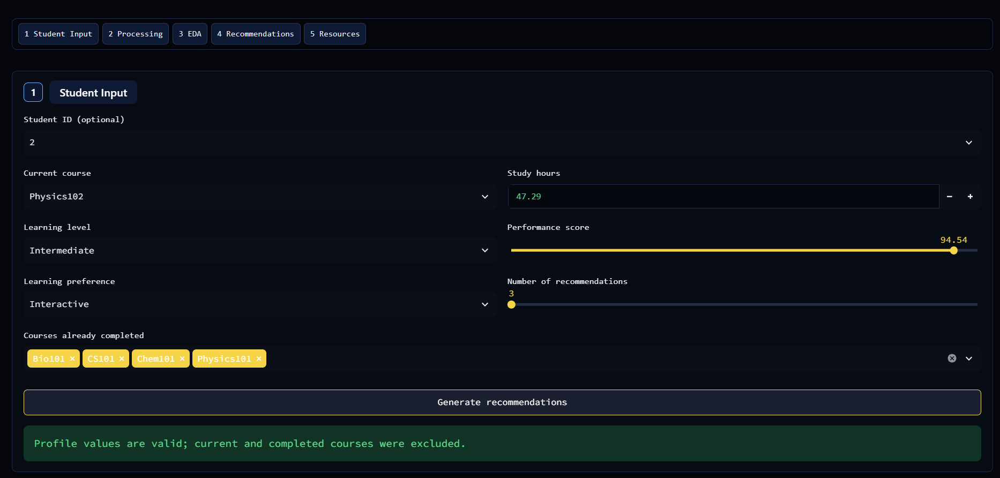
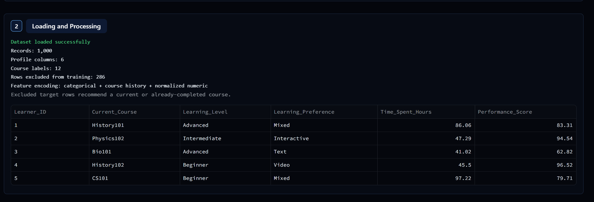
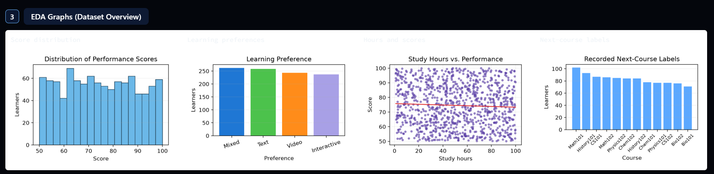
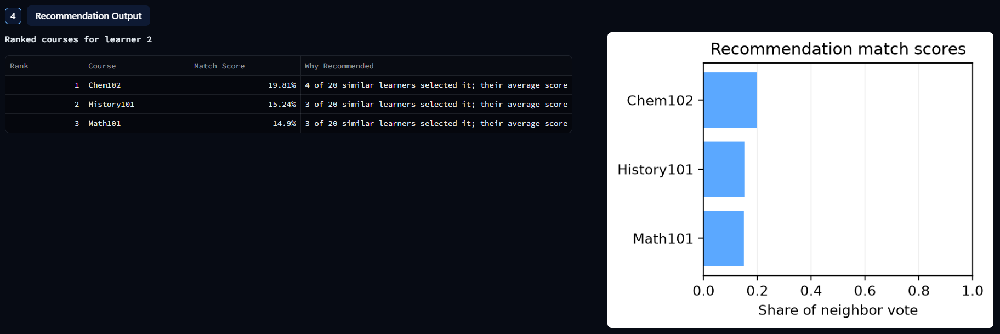
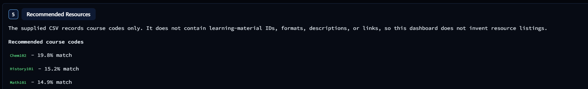

# 🎓 Learning Recommender System

### Personalized Learning Recommendations Using Machine Learning

[](https://www.python.org/)
[](https://streamlit.io/)
[](https://scikit-learn.org/)
[]()

## 📌 Project Overview

The **Learning Recommender System** is a machine-learning-based web application designed to provide personalized learning recommendations based on individual learner profiles, academic performance, learning preferences, and course history.

The system analyzes learner information and identifies similar learning profiles to recommend relevant next courses. It also provides recommendation match scores and explanations through an interactive Streamlit dashboard.

The primary goal is to make learning more personalized, data-driven, and accessible.

## 🎯 Project Objectives

- Analyze learner profiles and academic behaviour.
- Understand relationships between learner characteristics and course choices.
- Identify learners with similar profiles.
- Recommend relevant next courses using machine learning.
- Display ranked recommendations with match scores.
- Provide interactive visualizations for better understanding of learner data.

## ✨ Key Features

### 1. Student Input
- Load learner information from the dataset.
- Enter a learner profile manually.
- Select current and completed courses.
- Specify learning level and preferences.
- Enter study hours and performance scores.
- Choose between 3 and 10 recommendations.

### 2. Data Loading and Processing
- Load the learning dataset.
- Validate required columns.
- Review dataset statistics.
- Display learner records and course labels.
- Handle inconsistent recommendation targets.

### 3. Exploratory Data Analysis (EDA)
The dashboard includes four visualizations:

- Performance Score Distribution
- Learning Preferences Distribution
- Study Hours vs. Performance
- Recorded Next-Course Recommendation Distribution

### 4. Personalized Recommendation Engine
- Compares learner profiles.
- Identifies similar learners.
- Generates ranked course recommendations.
- Calculates recommendation match scores.
- Provides explanations for recommendations.

### 5. Recommended Resources
- Displays recommended course codes.
- Shows recommendation rankings.
- Explains available dataset information and limitations.

## 🧠 Machine Learning Methodology

The project follows a structured machine learning workflow:

1. Dataset loading and inspection.
2. Data cleaning and validation.
3. Exploratory Data Analysis.
4. Feature engineering.
5. Learner profile preprocessing.
6. Model training and evaluation.
7. Recommendation ranking.
8. Model serialization and integration.
9. Streamlit dashboard development.

The recommendation engine uses learner similarity, course history, and profile information to generate personalized recommendations.

## 📊 Model Evaluation

The model was evaluated using a stratified 80/20 holdout split.

Current evaluation results are based on 1,000 dataset rows.

| Evaluation Metric | Similar-Learner Model | Popularity Baseline |
|---|---:|---:|
| Top-1 Accuracy | 11.19% | 10.49% |
| Hit Rate at 5 | 53.15% | 45.45% |
| Mean Reciprocal Rank at 5 | 0.2472 | Not calculated |

**Dataset processing summary:**
- Total dataset records: 1,000
- Eligible records: 714
- Excluded inconsistent recommendation targets: 286

The results indicate that the similar-learner model outperforms the popularity baseline on Top-1 Accuracy and Hit Rate at 5.

These are offline, dataset-specific evaluation results and do not guarantee real-world recommendation quality.

## 🗂️ Project Structure

```text
Learning-Recommender-System/
│
├── app.py
├── train_model.py
├── requirements.txt
├── README.md
├── .gitignore
│
├── .streamlit/
│   └── config.toml
│
├── assets/
│   └── style.css
│
├── data/
│   └── learning_path_dataset.csv
│
├── docs/
│   └── PROJECT_DOCUMENTATION.md
│
├── models/
│   ├── metrics.json
│   └── recommender_model.joblib
│
└── src/
    ├── config.py
    ├── data_loader.py
    ├── eda.py
    ├── features.py
    ├── recommender.py
    ├── resources.py
    ├── ui_components.py
    └── validators.py
```

## 🛠️ Technology Stack

| Technology | Purpose |
|---|---|
| Python | Core programming language |
| Streamlit | Interactive web application |
| Pandas | Data manipulation and analysis |
| NumPy | Numerical computations |
| Scikit-learn | Machine learning and preprocessing |
| Matplotlib | Data visualization |
| Joblib | Model serialization |
| CSS | Dashboard styling |
| Git & GitHub | Version control and project hosting |

## 📁 Dataset Information

The project uses:

`data/learning_path_dataset.csv`

Required dataset columns:

- `Learner_ID`
- `Current_Course`
- `Completed_Courses`
- `Learning_Level`
- `Learning_Preference`
- `Time_Spent_Hours`
- `Performance_Score`
- `Next_Course_Recommendation`

The dataset contains learner attributes, course information, and recommendation labels.

**Dataset limitation:** The dataset does not contain actual course URLs, descriptions, videos, or learning material links. Therefore, the application recommends course codes rather than direct learning resources.

## 🚀 Installation and Setup

### Prerequisites

- Python installed
- Visual Studio Code
- Git

### Step 1: Clone the Repository

```bash
git clone https://github.com/naskarpriyatech-enthusiast/Learning-recommender-system.git

cd Learning-recommender-system
```

### Step 2: Create a Virtual Environment

**Windows PowerShell**

```bash
py -m venv .venv
```

### Step 3: Activate the Environment

```bash
.\.venv\Scripts\Activate.ps1
```

### Step 4: Install Dependencies

```bash
python -m pip install --upgrade pip

pip install -r requirements.txt
```

### Step 5: Train the Recommendation Model

```bash
python train_model.py
```

### Step 6: Run the Streamlit Application

```bash
streamlit run app.py
```

The application will open in your browser:

`http://localhost:8501`

## ☁️ Deployment

The application is designed for deployment using **Streamlit Community Cloud**.

Deployment steps:

1. Open Streamlit Community Cloud.
2. Sign in using GitHub.
3. Select Create App.
4. Choose this GitHub repository.
5. Select the `main` branch.
6. Set the main file path to `app.py`.
7. Click Deploy.

## Live Demo

Try the application here:

https://learning-recommender-system-priya.streamlit.app

**GitHub Repository:**  
https://github.com/naskarpriyatech-enthusiast/Learning-recommender-system

## Application Screenshots

### 1. Student Input


### 2. Processing


### 3. Exploratory Data Analysis


### 4. Learning Recommendations


### 5. Learning Resources


## 🔮 Future Improvements

- Integrate larger and more diverse learner datasets.
- Improve recommendation accuracy.
- Add course descriptions and direct learning links.
- Introduce advanced recommendation algorithms.
- Add user authentication and learner progress tracking.
- Develop personalized learning paths.
- Improve dashboard functionality and user experience.

## 👩‍💻 Author

**Priya Naskar**

BCA Student | Aspiring Software Developer | Machine Learning Enthusiast

GitHub: [naskarpriyatech-enthusiast](https://github.com/naskarpriyatech-enthusiast)

---


## 📘 Project Report Structure

The project report is organised into 14 chapters covering the complete development lifecycle of the **Learning Recommender System**, from problem identification and dataset analysis to machine learning implementation, evaluation, and future enhancements.

### 1. Abstract
Provides an overview of the Personalized Learning Recommender System, its purpose, the machine learning approach, technologies used, and the expected outcome. The system analyses learner profiles and recommends suitable next courses based on similarities between learners.

### 2. Introduction
Introduces personalized learning and the role of machine learning in modern educational platforms. Explains how learner characteristics, academic performance, learning preferences, and study behaviour can support more relevant learning recommendations.

### 3. Problem Statement
Explains the limitations of generic learning pathways, where learners may receive similar recommendations despite having different academic backgrounds, performance levels, and learning preferences. The project addresses this challenge through a data-driven recommendation approach.

### 4. Objectives
The main objectives are:
- Analyse learner profiles and academic information.
- Explore patterns in learning preferences and performance.
- Prepare and transform learner data for machine learning.
- Identify learners with similar learning characteristics.
- Generate ranked next-course recommendations.
- Present recommendation results through an interactive dashboard.

### 5. Literature Review
Discusses the concepts behind educational recommendation systems, collaborative filtering, content-based recommendation, similarity-based learning, and machine learning applications in education. Highlights how personalized recommendations can support learner engagement and decision-making.

### 6. Existing and Proposed System

**Existing System:**
- Generic learning recommendations.
- Limited consideration of individual learner profiles.
- Difficulty identifying suitable next courses based on learner similarity.

**Proposed System:**
- Learner-profile-based recommendation.
- Similarity-based learner retrieval.
- Ranked next-course suggestions.
- Interactive Streamlit dashboard with recommendation scores and visual analytics.

### 7. Dataset Description
Describes the `learning_path_dataset(4).csv` dataset used in the project. The supplied dataset contains 1,000 learner records and 8 columns. It includes learner-related information such as current course, learning level, learning preference, performance score, study time, and next-course recommendation labels.

The chapter covers dataset structure, feature descriptions, data quality checks, and exploratory analysis.

### 8. System Architecture
Explains the major components and flow of the application:

1. Dataset Input
2. Data Validation and Processing
3. Feature Engineering
4. Feature Vectorization
5. Similarity-Based Learner Retrieval
6. Next-Course Recommendation
7. Streamlit Dashboard and Results Visualization

### 9. Methodology
Describes the machine learning workflow, including:
- Dataset inspection and validation.
- Data preprocessing.
- Feature selection and engineering.
- Encoding categorical and numerical features.
- Similarity calculation using cosine similarity.
- Nearest-neighbour retrieval.
- Similarity-weighted recommendation ranking.
- Evaluation using an appropriate holdout procedure.

### 10. Implementation
Explains the practical development of the application using Python and Streamlit. Covers dataset loading, recommendation logic, dashboard development, interactive learner inputs, exploratory data analysis, recommendation generation, and deployment.

### 11. Results and Evaluation
Presents the actual outputs of the implemented system, including:
- Dataset analysis and visualisations.
- Learning-level and learning-preference distributions.
- Performance-score analysis.
- Study-time and performance relationship.
- Ranked course recommendations.
- Recommendation match-score visualisation.
- Functional testing and evaluation results.

Results are based on the supplied dataset and actual application outputs.

### 12. Conclusion
Summarises the development of the Personalized Learning Recommender System and explains how similarity-based recommendations can help identify relevant next-course options from learner data. Highlights the integration of machine learning with an interactive web application.

### 13. Future Scope
Potential improvements include:
- Integration of larger real-world educational datasets.
- Advanced hybrid recommendation techniques.
- Deep learning-based recommendation models.
- Learner progress tracking.
- Personalized learning-resource recommendations.
- User authentication and recommendation history.
- Continuous model evaluation and improvement.

### 14. References
Technical concepts and development resources:
- [Python Documentation](https://docs.python.org/3/)
- [Pandas Documentation](https://pandas.pydata.org/docs/)
- [Scikit-learn Documentation](https://scikit-learn.org/stable/)
- [Streamlit Documentation](https://docs.streamlit.io/)
- [NumPy Documentation](https://numpy.org/doc/)

---

**Note:** This section provides the project report outline and chapter summaries. The complete academic report, PPT, and college submission documents are maintained separately and are not included in this repository.


